# Checks and details

The Checks tab is backed by the real domain models. Each row keeps a `ProbeConfig` and its `ProbeState`; `ProbeListItem` requires the state to belong to the same configuration revision. The details screen renders the configuration revision, observations, outcome, freshness and measured phases without inventing missing values.

## List

- Search matches the check name, group name, target text and protocol identifier.
- Filters cover group, presentation status (`Up`, `Pending`, `Down`, `Unknown`, `Stale`) and protocol.
- All P0 request families are represented: TCP connect, TLS, HTTP, HTTPS, system DNS, DNS over UDP, DNS over TCP, DoH, DoT and ICMP.
- Each row shows status, freshness when it is stale or missing, an explicit `Skipped`/`Inconclusive`/`Restricted` badge where applicable, group, protocol, a monospaced target and the last elapsed time or error.
- Search and filter state survives navigation to details and back.
- `Add check` opens the check editor from both the empty and populated list. Every supported P0 protocol can be configured there; see [the check editor](CHECK_EDITOR.md).

## Details

The header shows the result status, freshness, presentation outcome and lifecycle separately. Configuration fields are specific to the protocol, including endpoints, SNI, minimum TLS, expected HTTP status/body marker, DNS name/record type/RCODE, resolver and ICMP packet criteria. A configured IP family is shown for TCP, TLS, HTTP/HTTPS, DoH, DNS over UDP/TCP and DoT. IPv6 endpoints with a port are formatted with brackets, such as `[2001:db8::1]:443`. `Probe ID` and `Revision` are preserved from the domain model; a changed request or timeout advances the revision.

The result card shows the outcome, recorded time and elapsed duration. Restricted results include `retryAt`; skipped results include the reason and next allowed time. A completed result retained after a later skipped slot keeps both records. A skipped slot older than a newer completed result is history, not the latest state, and is not shown as such. The phase card lists only phases reported by the runner and states that missing phases are not zero. The observations card shows connected IP family, HTTP status and body-marker state, DNS RCODE/answer count/truncation, negotiated TLS, and ICMP packets/loss/RTT. A null fact is rendered as `Not observed`, `Not checked` or `Not measured`, never as `0`.

`Run again` and `Edit check` are wired through nullable `ProbeActions` callbacks with a `ProbeKey`. `Edit check` opens the editor; production disables only saving and test requests until local storage and the network engine are connected. `Run again` remains disabled until the runner is connected. The debug harness uses an in-memory runner and profile repository for the editor demo; it sends no network request and persists nothing. History is an explicit placeholder until local storage is implemented.

| Presentation | What is shown |
| --- | --- |
| UNKNOWN | No data, no result, unknown status |
| STALE | Last result retained with a separate Stale badge |
| TIMEOUT | Down status and `Failed: Timeout`, with only measured phases |
| Inconclusive | Unknown result with a separate Inconclusive badge and reason |
| Restricted | Pending/unknown status with a Restricted badge, reason and retry time |
| Skipped | Unknown status, Skipped badge, skip reason and next attempt |

## Demo harness

`OverviewDemoActivity` contains 12 domain-backed checks covering all ten protocol variants and every presentation state. Every screen shows the demo banner; the editor demo can save into the activity session, but sends no network request and persists nothing.

```bash
adb shell am start -S -W -n io.github.chuck852.linksonda/.debug.OverviewDemoActivity \
  --es scenario PARTIAL --es tab CHECKS
adb shell am start -S -W -n io.github.chuck852.linksonda/.debug.OverviewDemoActivity \
  --es scenario PARTIAL --es probe https-global
```

Useful demo IDs include `https-global` (revision 2, matched HTTPS with phases), `tls-global` (stale), `https-retained` (a completed result retained after a later skipped slot), `http-regional` (timeout), `dns-tcp` (skipped without data), `doh` (inconclusive) and `dot` (restricted). Use `--es edit <id>` to open the editor for a demo check or `--es editor <PROTOCOL>` for a new check.

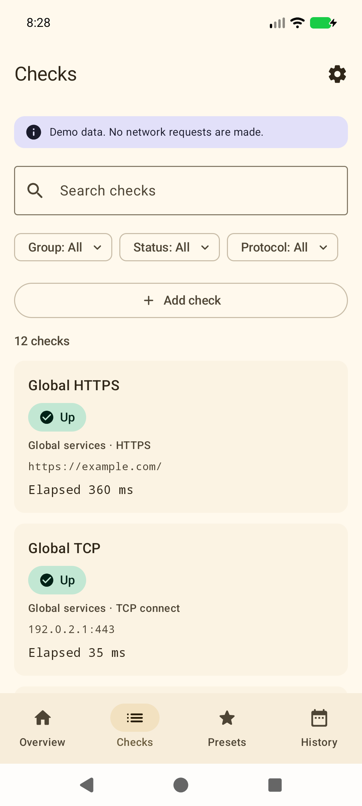

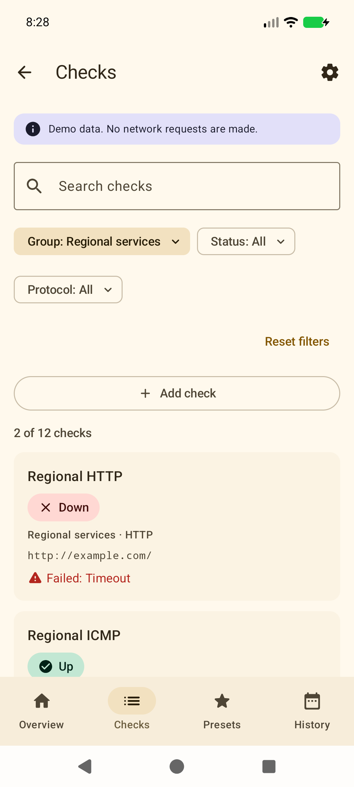

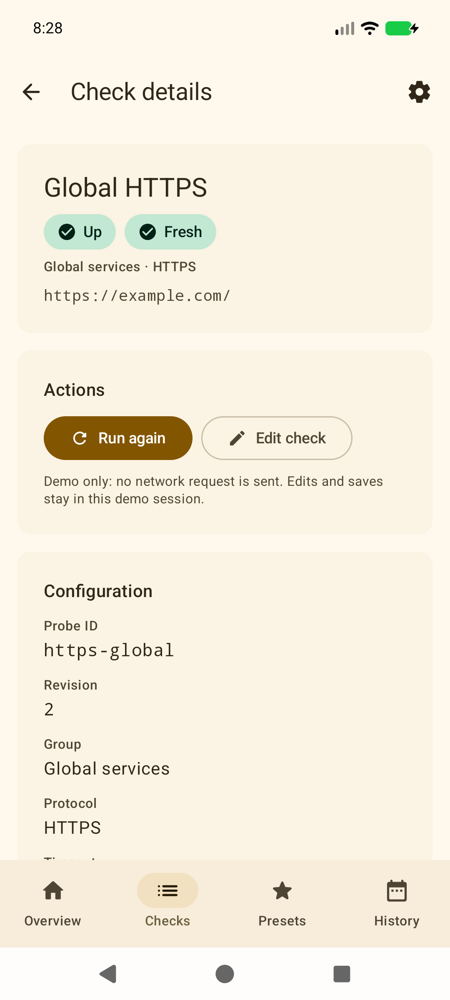

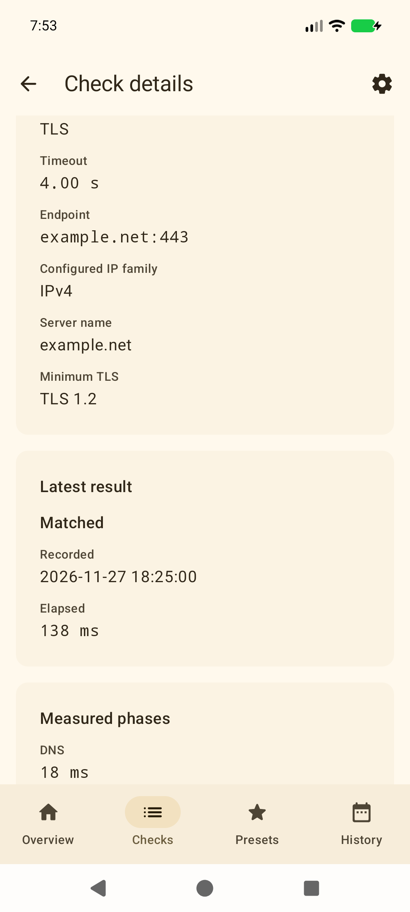

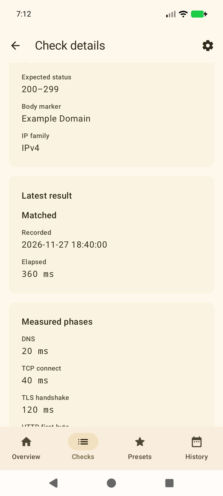

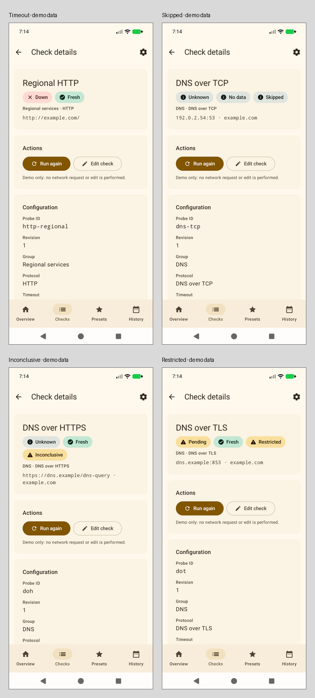

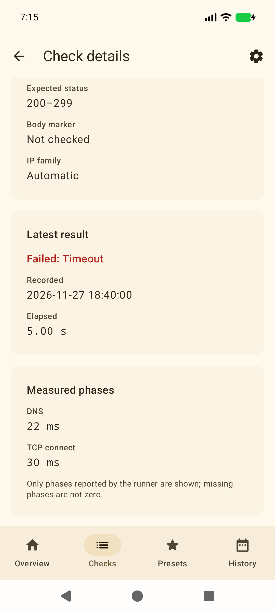

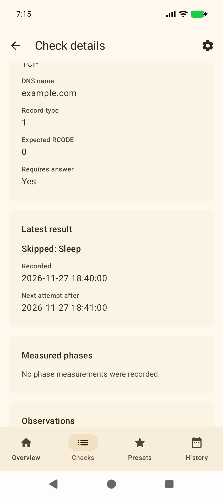

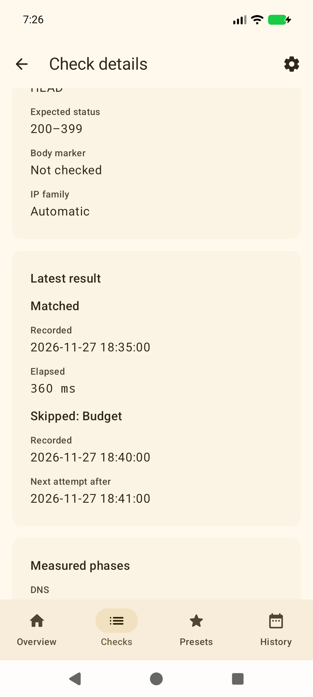

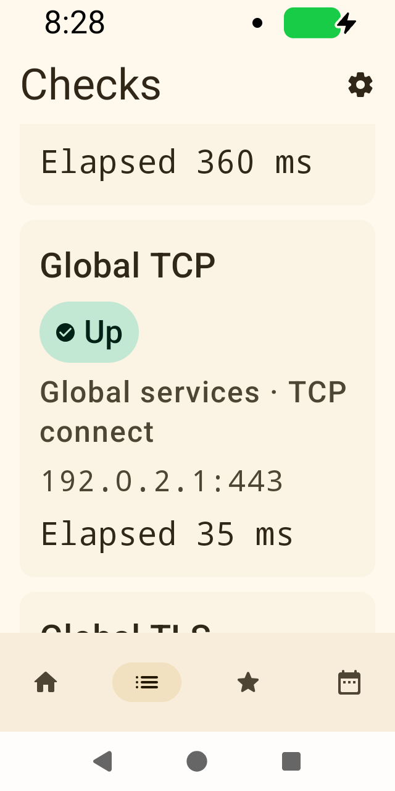

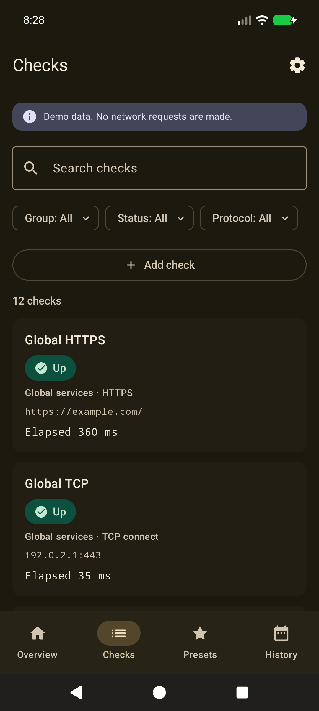

## Verification

- 73 JVM tests, including editor validation, every protocol round-trip, revision changes, protocol field resets, navigation and demo save/test contracts.
- Android 17 (API 37): search, group/status/protocol filters, filtered empty state, details navigation, back stack, light and dark themes checked.
- 320 dp width at 200% font scale: no horizontal overflow; labels and fields wrap; controls remain reachable.
- Release build excludes the demo activity, domain-backed demo catalog and demo resources.
- Lint reports 0 errors and 6 pre-existing warnings. No dependency versions changed.
- The AOSP image has no TalkBack service. The accessibility tree was checked with `uiautomator`; the separate screen-reader pass is tracked in #31.
