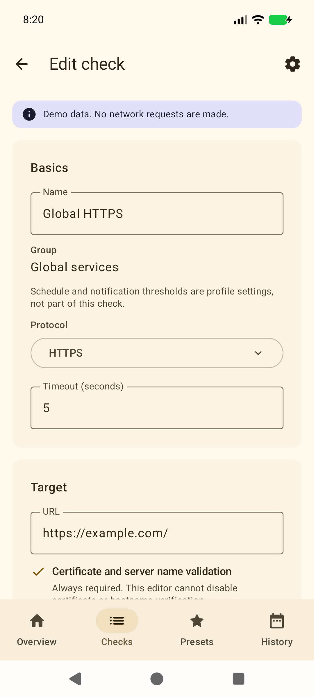
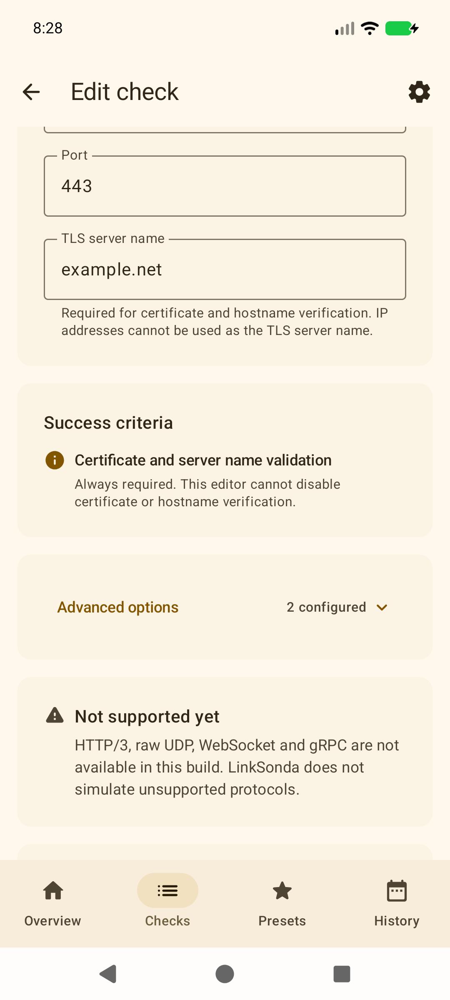
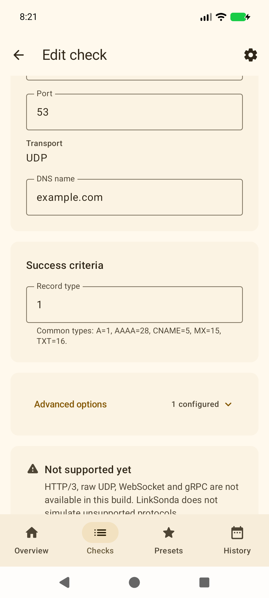
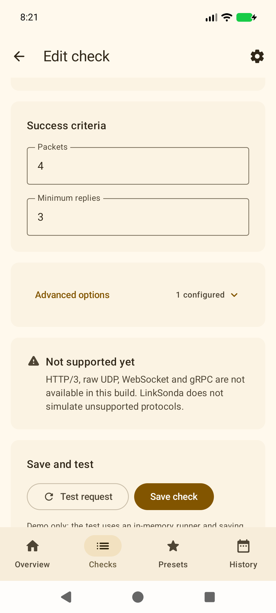
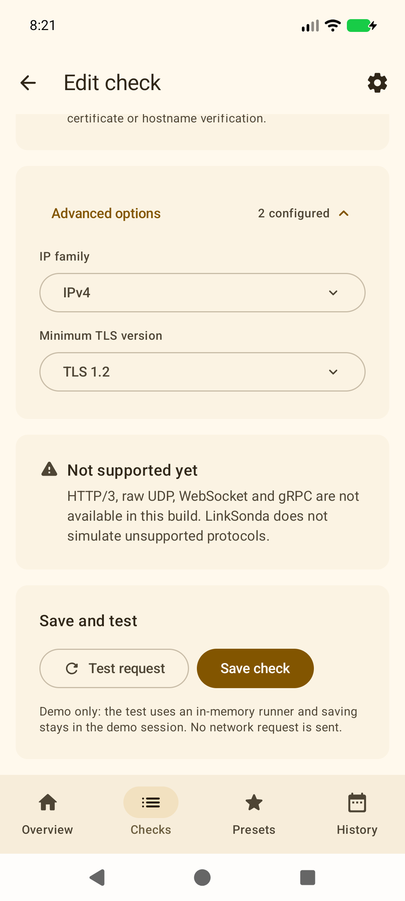
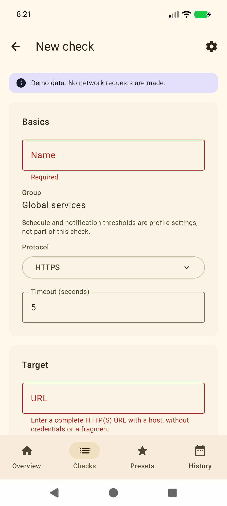
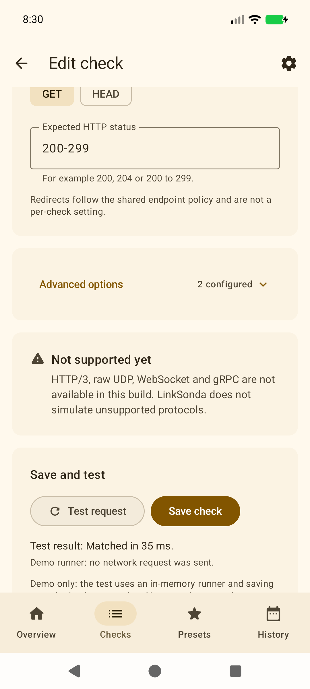
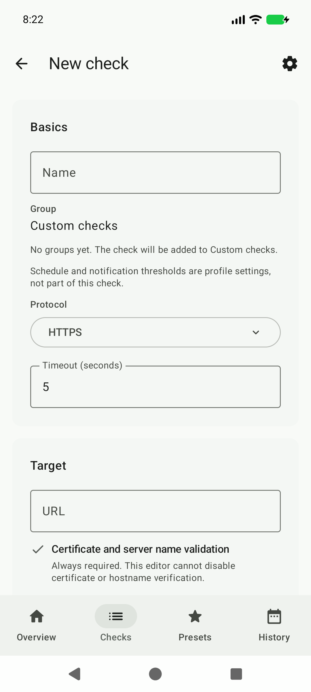
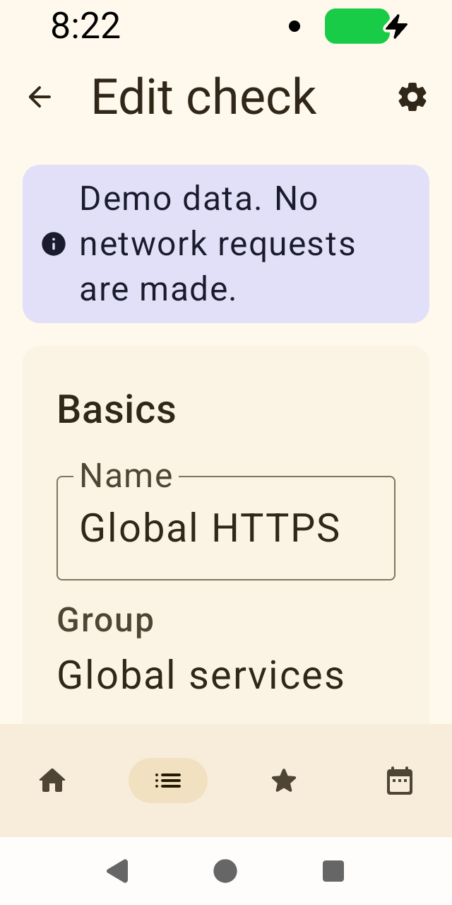
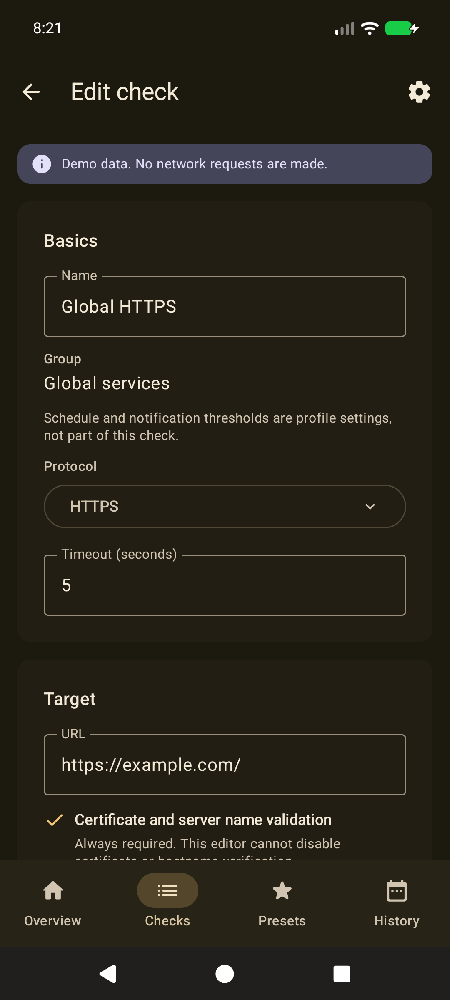

# Check editor

The check editor creates and edits every supported P0 probe with the real domain models. It is available from the Checks screen, including the empty state, and from the details screen.

## Supported protocols

The protocol selector covers all current P0 request families:

| Protocol | Target fields | Success criteria |
| --- | --- | --- |
| TCP connect | host, port | a completed TCP handshake |
| TLS | host, port, server name | certificate and hostname validation |
| HTTP | URL | method, expected status range, optional body marker |
| HTTPS | URL | method, expected status range, optional body marker |
| System DNS | DNS name | record type, expected RCODE, answer requirement |
| DNS over UDP | resolver host, port, DNS name | record type, expected RCODE, answer requirement |
| DNS over TCP | resolver host, port, DNS name | record type, expected RCODE, answer requirement |
| DNS over HTTPS | resolver URL, DNS name | record type, expected RCODE, answer requirement |
| DNS over TLS | resolver host, port, server name, DNS name | record type, expected RCODE, answer requirement |
| ICMP | host | packet count and minimum replies |

Changing the protocol clears fields that belong to the previous protocol and sets the new protocol defaults. The check name, group and timeout are preserved.

HTTP/3, raw UDP, WebSocket and gRPC are not offered. The editor names them explicitly and does not simulate an unsupported protocol. Redirects are controlled by the shared endpoint policy, not by a per-check switch. Schedule, notification thresholds and group monitoring are profile settings.

## Validation

The editor validates input before constructing `ProbeConfig`:

- Hostnames, IPv4 and IPv6 literals; IPv6 endpoints with a port are shown as `[2001:db8::1]:443`.
- Ports from 1 to 65535.
- Absolute HTTP/HTTPS URLs with a host and without credentials or fragments. DoH requires HTTPS.
- Timeouts from 0.1 to 120 seconds.
- HTTP status ranges from 100 to 599, in forms such as `204` or `200-299`.
- `HEAD` requests cannot use a body marker.
- DNS names, record types from 1 to 65535, RCODE from 0 to 4095, and the rule that a non-zero RCODE cannot require an answer.
- TLS and DoT server names must be DNS names. IP addresses are rejected as the TLS server name.
- ICMP packet count from 1 to 10 with at least one reply and no more replies than packets.
- A selected IP family must agree with a literal IPv4 or IPv6 address.

Invalid input never reaches `ProbeConfig`; the save and test actions show field-level errors and keep the editor open.

TLS certificate and hostname verification are always required. The editor has no switch that can disable them, and it states this next to the TLS target. The future runner performs the actual certificate validation; the editor never fakes a successful handshake.

## Revisions and field reset

A new check starts at revision 1. Editing a name only keeps the revision and its existing result. Changing the request or timeout calls `ProbeConfig.update`, which advances the revision and starts a new history key. The editor rebuilds the visible state from UNKNOWN when the revision changes, so a result from the previous definition is not shown as the current result.

## Contracts and current limits

`ProbeEditorActions` is the UI boundary:

- `onSave` receives a `ProbeDraft` with the domain `ProbeConfig`, group id and group name. The debug harness implements it with an in-memory `ProfileRepository`; production leaves it null until local storage is implemented.
- `onTest` receives a `ProbeConfig` and is implemented with the `ProbeRunner` contract. The debug harness uses a demo runner that authorizes an attempt through `ProbeAdmission`, returns a domain result and performs no network request. Production leaves it null until the network engine and admission controller are connected.

The production editor therefore shows both actions disabled with the exact reason. No temporary production repository, Room substitute or fake result was added. `LinkSonda` does not request network permissions for the editor, and the demo runner sends no traffic.

The debug-only `OverviewDemoActivity` saves checks into an in-memory `DemoProfileRepository` and displays the updated list for the current session. Nothing is persisted and release builds exclude these classes.

## Demo harness

```bash
# New check with a protocol preselected
adb shell am start -S -W -n io.github.chuck852.linksonda/.debug.OverviewDemoActivity \
  --es scenario PARTIAL --es editor TLS

# Edit an existing demo check
adb shell am start -S -W -n io.github.chuck852.linksonda/.debug.OverviewDemoActivity \
  --es scenario PARTIAL --es edit https-global
```

Useful edit IDs include `https-global` (URL, status and body marker), `tls-global` (server name, minimum TLS and IP family), `dns-udp` (resolver, transport, DNS name and record type), `doh`, `dot` and `icmp-regional`.

## Screenshots





















## Verification

- 73 JVM tests, 0 failures. Editor coverage includes all ten protocols, invalid host/URL/port/status/timeout, TLS server-name rules, protocol reset, revision changes and save/test contracts.
- `clean testDebugUnitTest lintDebug assembleDebug assembleRelease` passes; lint reports 0 errors and the same 6 pre-existing warnings.
- Android 17 (API 37): new check from the empty production list, edit from details, protocol-specific fields, validation errors, test through the demo runner and save into the demo session.
- 320 dp at 200% font scale: no horizontal overflow; fields and action buttons wrap and remain reachable.
- Light and dark themes checked.
- Release APK contains no demo editor actions, demo runner, demo repository or preview classes.
