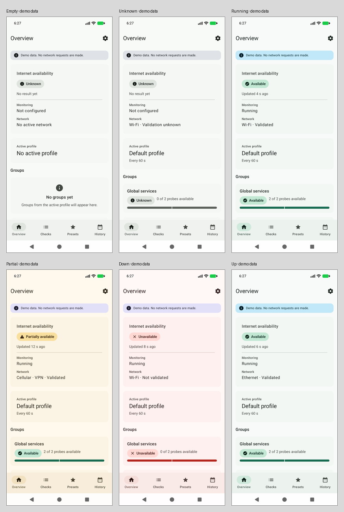
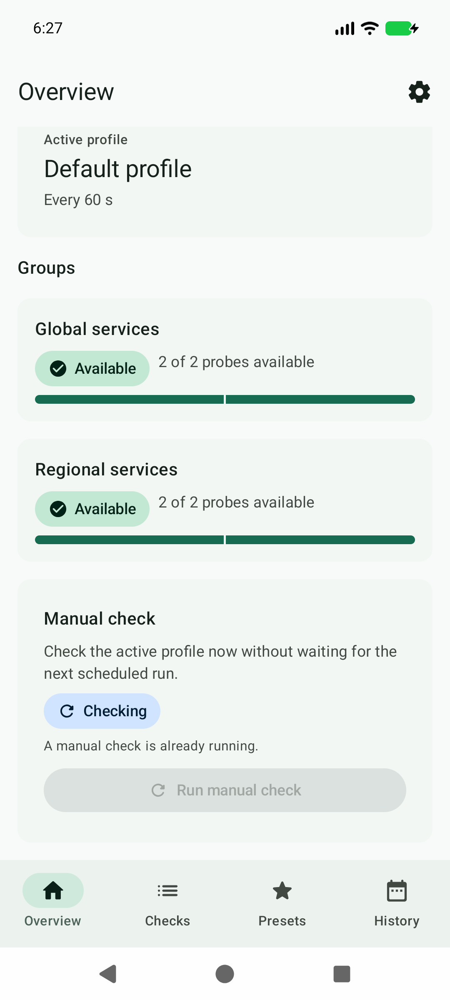

# Navigation and overview

The app shell implements the four approved top-level destinations: Overview, Checks, Presets and History. Settings opens from the top bar. Real probes and local storage are not connected yet, so production starts with an empty, unknown overview instead of demonstration values.

## Navigation model

`AppNavigationState` is a small saveable back stack in `ui/navigation`:

- selecting a bottom-bar tab returns to that tab's root;
- a group card opens the Checks tab filtered to that group;
- the filter chip clears the filter and stays on Checks;
- a check row opens details, and `Edit check` or `Add check` opens the check editor above Checks;
- Settings opens above the current tab;
- the top-bar back action and the Android system back action pop one entry;
- at a tab root, system back leaves the activity.

Groups, filters and settings use one back stack, so navigation does not depend on a separate navigation library. The stack is restored with `rememberSaveable` after configuration changes or process recreation.

## Overview

The overview shows:

- the confirmed aggregate status and its freshness;
- monitoring state;
- network transports, VPN and validation state when known;
- the active profile and schedule;
- clickable groups with an aggregate badge and an availability bar;
- a manual-check card.

The production state is `OverviewUiState.Empty`: UNKNOWN availability, no result, network context unknown, no profile, no groups and a disabled manual check with an explanation. The screen never invents a result. Demo states exist only in the debug source set.

## Checks, presets, history and settings

Checks shows all probes or a filtered subset. Search covers names, groups, targets and protocols; filters cover group, status and protocol. Each row contains the name, protocol, target, result badge and latency, failure, skip or inconclusive reason. Opening a row shows the full configuration, result, measured phases and observations. The `Add check` action is available from the empty and populated list, and `Edit check` opens the same editor. See [checks and details](CHECKS.md) and [the check editor](CHECK_EDITOR.md).

Presets and History currently show honest empty states. Settings opens a placeholder until the settings and localization issue is implemented. The empty states do not imply that monitoring is running.

## Presentation states

| State | What is shown |
| --- | --- |
| Empty | UNKNOWN aggregate, no profile, no groups, disabled manual check |
| Unknown | profile and groups with UNKNOWN results and no fresh data |
| Running | last confirmed aggregate stays visible; the manual check shows a separate blue Checking badge |
| Partial | PARTIAL aggregate, mixed group and probe results |
| Down | UNAVAILABLE aggregate and failed probes with reasons |
| Up | AVAILABLE aggregate, group bars and latency values |

A running check never replaces the last confirmed aggregate. Result and lifecycle remain separate components from the theme.

## Demo harness

The debug-only `OverviewDemoActivity` renders the same screens with clearly marked demonstration data. It makes no network request and persists nothing.

```bash
adb shell am start -S -W -n io.github.chuck852.linksonda/.debug.OverviewDemoActivity \
  --es scenario PARTIAL --es tab OVERVIEW
```

Supported scenarios are `EMPTY`, `UNKNOWN`, `RUNNING`, `PARTIAL`, `DOWN` and `UP`. `--es tab CHECKS|PRESETS|HISTORY` opens a tab, `--es filter regional` opens the filtered Checks screen, `--es edit <id>` opens an existing check in the editor and `--es editor <PROTOCOL>` starts a new check. Every demo screen displays the banner “Demo data. No network requests are made.”





## Layout and accessibility

- Screen padding is 16 dp; cards use 16–20 dp internal padding.
- Group cards and navigation items have at least a 48 dp touch target.
- Status always has text and an icon; color is not the only carrier.
- Technical targets use a monospaced font.
- Status badges allow two lines so long labels are not truncated at large font scales.
- At font scales of 150% and above the bottom bar hides labels to avoid clipped or letter-by-letter wrapping. Each icon keeps its accessible content description, and the selected item remains visually distinct.
- Group names and badges stack or wrap rather than forcing the name into a narrow column.

## Verification

- 73 JVM tests cover the domain model, build configuration, theme contrast and palettes, navigation stack, overview state filtering, editor validation and demo-scenario consistency.
- Android 17 (API 37) emulator: all six states rendered at 1080 × 2400; group tap opened the filtered Checks screen and system back returned to Overview; tabs and Settings navigation were exercised.
- Small screen: 320 dp width with 200% font scale has no horizontal overflow; status labels wrap and bottom-bar icons retain content descriptions.
- Lint reports 0 errors and 6 pre-existing warnings. No dependency versions were changed.
- The AOSP emulator image has no TalkBack service. The accessibility tree was checked with `uiautomator` (roles, labels, bounds), but a screen-reader pass on a device remains to be done.
