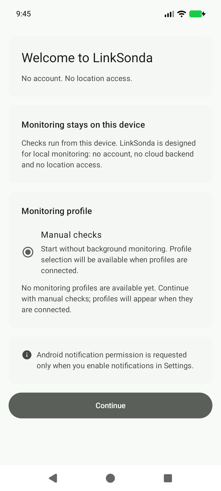
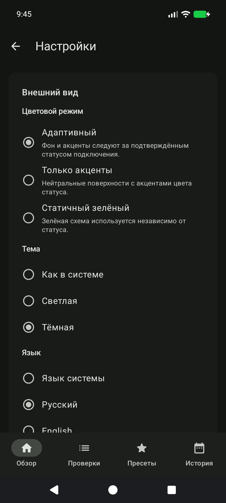
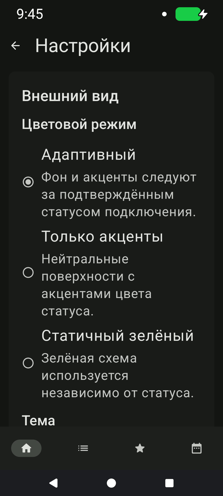

# Settings, localization and first run

LinkSonda stores user preferences locally and applies the selected language and theme before the main screen appears. The first launch explains the local monitoring model and offers a starting profile when one is available.

## First run

The first-run screen states that checks run from the device, LinkSonda is designed for local monitoring, and it has no account, cloud backend or location access. The user can continue with manual checks or choose an available monitoring profile. No placeholder profiles are created: until presets and profiles are connected, the manual option is the only one shown.

Notifications are not requested during onboarding. Android asks for `POST_NOTIFICATIONS` only when the user enables notifications in Settings.

## Settings

| Section | Options |
| --- | --- |
| Appearance | Adaptive, accents-only or static-green color mode; system, light or dark brightness; system, English or Russian language |
| Monitoring | Background-monitoring switch; disabled with an explanation until the monitoring engine is connected |
| Notifications | Incident-notification switch; permission is requested only when enabling it |
| History | 7, 30, 90 or 365 days; used by the local retention maintenance |
| Updates | Automatic checks, Stable/Preview channel, manual check, current/available version, release notes and install actions |
| Local data | A statement that settings and history are designed to stay on the device, plus the app version |

The Updates section is separate from monitoring: GitHub failures are shown as update status and never change a probe state. If notification permission is denied, the switch remains off and Settings explains that other features continue to work and that permission can be changed in Android settings. The rationale is stored with the preference, so it survives leaving the screen and process recreation. On resume the app rechecks the OS permission: a revoked permission turns the effective switch off, keeps the user's preference and shows the same explanation. A denial does not block the editor, the checks list or any other screen.

## Persistence boundary

`AppSettings` is a UI-independent model. `SettingsStore` is the contract consumed by the app, and `SettingsStorage` isolates the platform key-value adapter. The production adapter is `DataStoreSettingsStorage`; it migrates the earlier SharedPreferences file once and keeps the same preference keys. DataStore is authoritative. A small synchronous startup snapshot is retained only because `MainActivity.attachBaseContext` must choose the locale before the first frame; it is read from the last successfully written SharedPreferences snapshot, so no DataStore read or `runBlocking` runs on the main thread. `SettingsStore.initialize()` asynchronously replaces it with DataStore values and blocks writes until that load completes; the startup snapshot is repaired from DataStore after an interrupted write. See [local storage](STORAGE.md).

The selected language is applied in `MainActivity.attachBaseContext`, so resources are correct on the first frame after a cold start. Changing the language saves the setting and recreates the activity. On API 33+ `LocaleManager.setApplicationLocales` keeps the platform per-app language picker in sync; `SYSTEM` clears that override and follows the device or system picker locale. For an explicit app language, the in-app setting wins over a later system-picker change; the system picker is authoritative only in `SYSTEM`. `res/xml/locales_config.xml` exposes English and Russian to the platform picker. API 26–32 use only the configuration context.

Theme mode and brightness are passed to `LinkSondaTheme`; adaptive mode still changes only after a confirmed aggregate status. The UI never derives a palette from an individual failed probe or an in-flight manual check.

## Accessibility

Settings rows use selectable or toggleable semantics with radio/switch roles, section and subsection headings are exposed to heading navigation, state descriptions announce selected/on/off values, and the denial rationale uses a polite live region. Interactive rows keep a minimum 48 dp target. The first-run and Settings screens scroll at 200% font scale without horizontal clipping. The emulator used for verification did not include the TalkBack package, so the semantics tree and target bounds were checked with UI Automator; a full screen-reader pass remains part of the accessibility work tracked publicly in #31.

## Verification

- 257 JVM tests, 0 failures, including the storage and updater tests.
- `./gradlew testDebugUnitTest lintDebug assembleDebug` and `assembleRelease` passed.
- Android 17 (API 37) emulator: first run, profile selection in the debug harness, completion, Russian/English switch, platform app-locale synchronization, language and dark-theme persistence after force-stop, notification permission denial and rationale persistence, permission revocation while enabled, editor access after denial, and 200% font scale.
- Release APK contains the Russian resources and no demo screens or demo settings data.

## Screenshots

