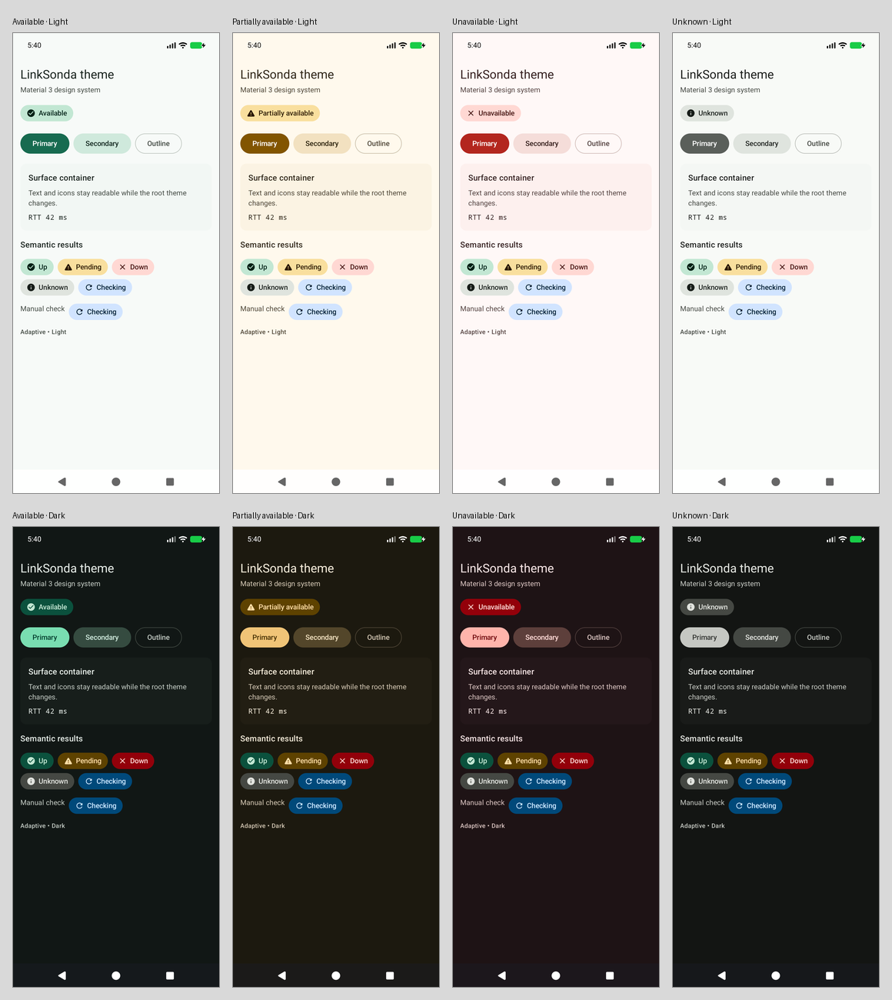

# Theme and design system

The design system lives in `app/src/main/java/io/github/chuck852/linksonda/ui/theme`. It implements the approved adaptive Material 3 theme from the product design and leaves navigation and screen composition to the next issues.

## Modes and brightness

`LinkSondaTheme` accepts three independent choices:

| Setting | Values | Behavior |
| --- | --- | --- |
| Mode | `ADAPTIVE` (default), `ACCENTS`, `STATIC` | Adaptive changes backgrounds, surfaces, buttons and accents. Accents keeps the green-neutral surface ramp and changes accent roles. Static always uses the green scheme. |
| Brightness | `SYSTEM` (default), `LIGHT`, `DARK` | System follows the Android setting. |
| Confirmed status | `ConfirmedAggregateStatus` | Only a confirmed aggregate status can change the adaptive palette. |

The aggregate status is deliberately wrapped in `ConfirmedAggregateStatus`. Callers keep the last confirmed value while a manual check is running. `ProbeLifecycleBadge` renders `RUNNING` separately and never replaces availability. A single probe failure does not change the root theme. Status and navigation bar icon appearance follows the effective light or dark brightness.

## Aggregate palettes

The starting tokens match the agreed design. `LinkSondaPalettes` expands them to the complete Material 3 `ColorScheme`, including `on*`, container, outline, inverse, surface-container and fixed roles.

| Status | Dark background / surface / primary | Light background / surface / primary |
| --- | --- | --- |
| Available | `#111715` / `#202E26` / `#79DDB1` | `#F7FAF8` / `#E7EFEB` / `#176B50` |
| Partially available | `#1C190F` / `#302B1C` / `#F0C477` | `#FFF9ED` / `#F4EAD6` / `#825500` |
| Unavailable | `#1E1315` / `#322125` / `#FFB4AB` | `#FFF8F7` / `#F8E4E1` / `#B3261E` |
| Unknown | Neutral gray | Neutral gray |

Error roles use the Material baseline red so that an error remains distinguishable from a status accent. Fixed roles reuse the status tonal ramp.

## Motion

Adaptive and accent status changes animate all 48 root color roles together with a 650 ms `tween` and `FastOutSlowInEasing`. No size, padding, typography or shape changes are part of the transition, so composition does not move.

Compose animation-core applies the Android `MotionDurationScale`. When system animations are disabled, the transition completes on its first frame. Mode and brightness changes snap to the new palette instead of interpolating through mixed light/dark colors, which could reduce contrast.

## Semantic result colors

Semantic tones are independent of the adaptive aggregate theme. They depend only on light/dark brightness and are provided through `LinkSondaTheme.semanticColors`.

| Tone | Meaning | Light accent / container | Dark accent / container |
| --- | --- | --- | --- |
| Positive | UP | `#176B50` / `#C2E7D3` | `#79DDB1` / `#0B513D` |
| Warning | PENDING, partially available | `#825500` / `#F9DF9E` | `#F0C477` / `#5E4200` |
| Negative | DOWN | `#B3261E` / `#FFD8D3` | `#FFB4AB` / `#93000A` |
| Neutral | UNKNOWN | `#5A5F5A` / `#DFE4DE` | `#C5C7C2` / `#454843` |
| Running | Local manual or scheduled execution | `#00639B` / `#D1E4FF` | `#8FD0FF` / `#00497A` |

`StatusBadge`, `AggregateStatusBadge`, `ProbeStatusBadge` and `ProbeLifecycleBadge` always render text and an icon. Result badges and lifecycle badges are separate: a running check does not overwrite the last known probe result. Color is not the only carrier of information.

## Preview and screenshots

Compose previews for all four statuses in light and dark themes, both accent and static modes, and the system dark theme are in `app/src/debug/java/.../ui/theme/ThemePreviews.kt`. The showcase layout and its strings also live in the debug source set. `ui-tooling` and `ui-tooling-preview` are debug-only dependencies, so previews and demonstration UI are not compiled into release builds.

For emulator screenshots, the debug build contains a non-release harness:

```bash
adb shell am start -S -W -n io.github.chuck852.linksonda/.debug.ThemeShowcaseActivity \
  --es status PARTIAL --es mode ADAPTIVE --es brightness DARK
```

The `-S` flag stops an existing instance before applying the extras.

Supported extras are `status` (`AVAILABLE`, `PARTIAL`, `UNAVAILABLE`, `UNKNOWN`), `mode` (`ADAPTIVE`, `ACCENTS`, `STATIC`), `brightness` (`SYSTEM`, `LIGHT`, `DARK`), `initialStatus` and `delayMs`. The last two schedule a status change for animation checks.



The screenshot above was captured on an Android 17 (API 37) AOSP emulator from the debug harness.

## Verification

`ThemeContrastTest` checks 34 foreground/background role pairs, including text, icons, outlines, containers, inverse roles and all primary, secondary and tertiary fixed roles:

- text pairs, including `onPrimaryFixedVariant` on `primaryFixedDim` and the equivalent secondary and tertiary pairs: WCAG contrast at least 4.5:1;
- non-text outlines and accents: at least 3:1;
- decorative `outlineVariant`: at least 1.5:1.

The same pairs are checked at 101 points of every ordered transition between the four statuses in adaptive and accents modes, using the same Oklab interpolation as Compose animations. `ThemePaletteTest` verifies mode behavior, the neutral UNKNOWN palette, semantic independence, running lifecycle mapping and the approved 650 ms duration.

Device checks on Android 17 (API 37) confirmed:

- all eight light/dark status screenshots use the same 1080 × 2400 surface and identical bounds for the title, surface card, semantic section and footer;
- at 200% font scale the showcase controls and status badges wrap through `FlowRow` without clipping or horizontal overflow;
- with animations enabled, the root primary color changed over about 0.6 s of a 60 fps screen recording, consistent with the 650 ms tween;
- with `animator_duration_scale=0`, the same change completed between adjacent frames in at most 17 ms.

A release APK built with `assembleRelease` contains only `MainActivity` in its manifest. It has no `ThemeShowcaseActivity`, no `theme_preview_*` resources and no `ThemeShowcase` or `ThemePreviews` class names, while the debug APK contains all of them.

Material You is not enabled. It remains an option only for the static mode and needs a separate design decision. Localization of status labels belongs to the settings and localization issue.
